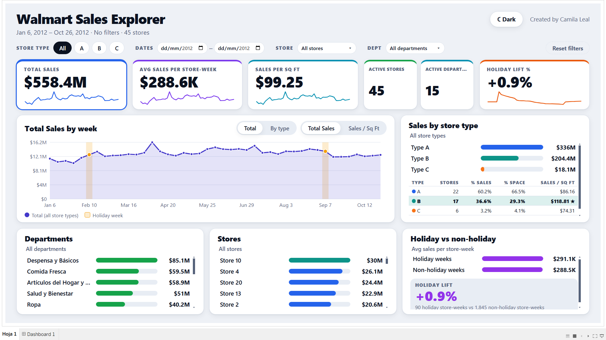

**🌐 Language:** [**English**](README.md) · [Español](README_ES.md)

# Walmart Sales Intelligence
### Python | Pandas | Tableau Studio | AI-Assisted Data App

**[▶ Open interactive dashboard](https://camilalealle.github.io/walmart-ai-sales-intelligence/)** · No account required once GitHub Pages is enabled

An end-to-end retail analytics project covering weekly sales for **45 Walmart stores and 15 departments** (January–October 2012). I prepared and validated the data in Python, built an interactive Data App with Tableau Studio, and adapted it into a standalone web app anyone can open.

### Key findings at a glance

- **Type B stores are the most productive.** They generate **$118.81 in sales per sq ft**, 38% more than Type A stores ($86.16). The 8 most productive stores are all Type B.
- **The peak week was the week before Easter** (April 6, 2012: $16.15M, 24% above the weekly average), even though the dataset does not flag Easter as a holiday.
- **The flagged holidays barely moved sales in 2012 (+0.9%).** The two flagged holiday weeks in the period correspond to the Super Bowl and Labor Day. The holidays with the most impact on retail sales (Thanksgiving and Christmas) fall outside the period.

---

## Interactive Dashboard



**Walmart Sales Explorer** lets users analyze weekly sales, compare store types, rank departments and stores, and evaluate holiday weeks, with filters by date, store type, store and department, drill-down from department to store to weekly detail, and light/dark modes.

The app was originally built as a Tableau Data App with Tableau Studio and connected to a data source published on Tableau Cloud. I then adapted it into a standalone web application (`docs/`) so it can be opened publicly without a Tableau account.

---

## Business Questions

1. How did weekly sales evolve throughout the period?
2. Which departments contributed the most to total sales?
3. How did performance differ across store types A, B and C, both in total sales and in productivity per square foot?
4. Which stores generated the highest sales?
5. How did average sales differ between holiday and non-holiday weeks?

---

## Key Findings

### 1. Store productivity: Type B stores make the most of their space

| Store Type | Stores | Total Sales | Share of Sales | Share of Space | Sales per Sq Ft |
|---|---:|---:|---:|---:|---:|
| A | 22 | $336.0M | 60.2% | 66.5% | $86.16 |
| **B** | **17** | **$204.4M** | **36.6%** | **29.3%** | **$118.81** |
| C | 6 | $18.1M | 3.2% | 4.1% | $74.31 |

Type A stores lead in total sales because they are larger. Measured by productivity, though, **Type B stores generate 38% more sales per square foot than Type A stores**. The 8 most productive stores by sales per sq ft are all Type B, led by **Store 10 ($237 per sq ft)**, which is also the top store by total sales ($30.0M).

### 2. Weekly sales: the peak came before Easter, not on a flagged holiday

| Metric | Week | Sales |
|---|---|---:|
| Peak week | April 6, 2012 | $16.15M |
| Lowest week | January 27, 2012 | $10.22M |
| Weekly average | | $12.99M |

The highest-selling week was the week leading up to Easter (April 8, 2012), 24% above the weekly average. Easter is not marked as a holiday in the dataset, so a holiday analysis based only on the existing flag misses the strongest seasonal peak in the period.

### 3. Departments: three departments drive over a third of sales

The top three departments (**Despensa y Básicos, Comida Fresca and Artículos del Hogar y Papel**) account for **36.4% of total sales**.

### 4. Holiday weeks: a small, descriptive difference

Average sales per store-week were **0.9% higher in holiday weeks** ($291.1K vs. $288.5K). This figure needs context:

- The period includes only two flagged holiday weeks: the **Super Bowl week** (week ending February 10) and **Labor Day week** (week ending September 7).
- In Type A and B stores, Super Bowl week sold **below** an average non-holiday week. Only Labor Day was above average.
- **Thanksgiving and Christmas fall outside the period**, so this result says nothing about the peak retail season.

This is a descriptive comparison. It does not establish a causal holiday effect.

---

## Recommendation

Before expanding large Type A formats, **study what drives Type B productivity** (assortment, location and store size) and test whether those practices can be replicated in other stores. To measure the real holiday effect, extend the analysis to the 2010–2011 data, which includes Thanksgiving and Christmas, and consider flagging Easter week.

---

## How AI Was Used

The Data App was generated with **Tableau Agent in Tableau Studio**. I treated its output as a draft, checked the KPIs against Python results, and refined the metric definitions and visuals.

- **Sales per Sq Ft formula.** The generated calculation divided the sales of all selected stores by the size of one average store, inflating grouped values (Type B showed $46.97 instead of $118.81). I corrected it to use the combined area of distinct stores.
- **Redundant metrics.** I removed trend-chart tabs that duplicated Total Sales (the average per store-week has the same shape when the store count is constant) or showed a flat line (active stores).
- **Misleading chart.** I removed a cumulative holiday-lift line that read like a weekly metric.
- **Consistent definitions.** I standardized the average to a single definition (per store-week) across KPI cards and charts.

---

## Dataset Overview

| Metric | Value |
|---|---:|
| Records analyzed | 28,845 |
| Stores | 45 |
| Departments | 15 |
| Observed weeks | 43 |
| Observed store-weeks | 1,935 |
| Total sales | $558.4M |
| Average sales per store-week | $288.6K |
| Sales per sq ft (period) | $95.24 |

**Source:** public Walmart store sales dataset (*Walmart Recruiting – Store Sales Forecasting*, Kaggle). Department names were translated to Spanish. Academic project, not affiliated with Walmart.

---

## Data Preparation and Quality

Data preparation and exploratory analysis were performed with **Python and Pandas**:

- Importing and examining the original datasets.
- Validating column types and date formats.
- Reviewing missing values and duplicate records.
- Integrating store and department information.
- Investigating negative sales records (10 records in 2012, retained rather than removed).
- Treating missing store-department-week combinations as unobserved, not as zero sales.
- Validating aggregated business metrics before and after visualization.

Full analysis: [`notebooks/01_data_profiling.ipynb`](notebooks/01_data_profiling.ipynb)

---

## Metric Definitions

| Metric | Formula | Notes |
|---|---|---|
| Average Sales per Store-Week | Total Sales ÷ distinct observed store-week combinations | One definition used across the whole app |
| Sales per Sq Ft | Total Sales ÷ combined area of distinct stores | Each store's area counted once. Cumulative for the selected period, not weekly or annualized |
| Holiday Lift | (Avg holiday store-week sales ÷ Avg non-holiday store-week sales) − 1 | Descriptive, not causal |

Store size is interpreted as square footage, consistent with the original dataset documentation.

---

## Technology Stack

| Technology | Purpose |
|---|---|
| Python, Pandas | Data processing, cleaning and validation |
| Jupyter Notebook | Exploratory analysis and documentation |
| Tableau Studio (Tableau Agent) | AI-assisted Data App development |
| Tableau Cloud | Published data source and Data App hosting |
| HTML, CSS, JavaScript | Standalone interactive web application |
| Git, GitHub, GitHub Pages | Version control and public deployment |

---

## Project Structure

```text
walmart-ai-sales-intelligence/
├── data/
│   ├── raw/
│   └── processed/
├── docs/                          # Standalone web app (GitHub Pages)
│   ├── index.html
│   ├── data.json
│   └── src/
│       ├── app.js
│       └── styles.css
├── images/
│   └── dashboard_overview.png
├── notebooks/
│   └── 01_data_profiling.ipynb
├── scripts/
│   └── build_web_data.py          # Builds docs/data.json from the processed CSV
├── tableau/
│   └── walmart_sales_explorer.twbx    # Data App built with Tableau Studio
├── .gitignore
├── README.md
└── README_ES.md
```

---

## Run Locally

```bash
python -m http.server 8000 --directory docs
```

Then open `http://localhost:8000`. The app needs a local server to load `data.json`; opening `index.html` directly will not work.

To regenerate the data file:

```bash
python scripts/build_web_data.py data/processed/walmart_sales_2012.csv docs/data.json
```

---

## Limitations

- The analysis covers January–October 2012, not the full year.
- Only two flagged holidays fall within the period; Easter is not flagged.
- Some store-department-week combinations are absent.
- Negative sales records are retained.
- The dataset does not support profit, margin or ROI analysis.
- The web version uses a static snapshot of the data, not a live Tableau connection.

---

## Author

**Camila Leal Ledesma**
Production Engineer | Data Analyst
Medellín, Colombia

[LinkedIn](https://www.linkedin.com/in/camila-leal-ledesma) · [Portfolio](https://camilalealle.github.io)
