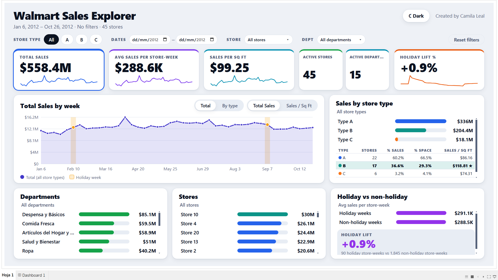

**🌐 Idioma:** [English](README.md) · [**Español**](README_ES.md)

# Walmart Sales Intelligence
### Python | Pandas | Tableau Studio | Data App asistida por IA

**[▶ Abrir el dashboard interactivo](https://camilalealle.github.io/walmart-ai-sales-intelligence/)** · Sin iniciar sesión, una vez activado GitHub Pages

Proyecto integral de analítica comercial que estudia las ventas semanales de **45 tiendas Walmart y 15 departamentos** (enero–octubre de 2012). Preparé y validé los datos en Python, desarrollé una Data App interactiva con Tableau Studio y la adapté a una aplicación web independiente que cualquier persona puede abrir.

### Hallazgos principales

- **Las tiendas tipo B presentan la mayor productividad por superficie.** Generan **118,81 por pie cuadrado en ventas acumuladas durante el período**, un 38 % más que las tiendas tipo A (86,16). Las ocho tiendas con mayor productividad pertenecen al tipo B.
- **La semana de mayores ventas fue la anterior a Pascua** (6 de abril de 2012: 16,15 millones, un 24 % por encima del promedio semanal), aunque el dataset no identifica Pascua como festivo.
- **Las semanas señaladas como festivas registraron una diferencia pequeña (+0,9 %).** Las dos semanas marcadas corresponden al Super Bowl y al Día del Trabajo en Estados Unidos (*Labor Day*). Acción de Gracias y Navidad quedan fuera del período analizado.

---

## Dashboard interactivo



**Walmart Sales Explorer** permite estudiar la evolución de las ventas, comparar tipos de tienda, clasificar departamentos y tiendas y evaluar las semanas festivas. Incluye filtros por fecha, tipo de tienda, tienda y departamento; exploración desde departamento hasta tienda y detalle semanal; además de modos claro y oscuro.

La aplicación se creó originalmente como una Tableau Data App en Tableau Studio, conectada a una fuente publicada en Tableau Cloud. Posteriormente la adapté a una aplicación web independiente (`docs/`) para permitir el acceso público sin cuenta de Tableau.

---

## Preguntas de negocio

1. ¿Cómo evolucionaron las ventas semanales durante el período?
2. ¿Qué departamentos contribuyeron más a las ventas totales?
3. ¿Cómo se comparan las tiendas tipo A, B y C en ventas totales y productividad por pie cuadrado?
4. ¿Qué tiendas generaron mayores ventas?
5. ¿Cómo difieren las ventas promedio entre semanas festivas y no festivas?

---

## Hallazgos principales

### 1. Productividad: las tiendas tipo B aprovechan mejor su superficie

| Tipo de tienda | Tiendas | Ventas totales | Participación en ventas | Participación en superficie | Ventas por pie² |
|---|---:|---:|---:|---:|---:|
| A | 22 | 336,0 M | 60,2 % | 66,5 % | 86,16 |
| **B** | **17** | **204,4 M** | **36,6 %** | **29,3 %** | **118,81** |
| C | 6 | 18,1 M | 3,2 % | 4,1 % | 74,31 |

Las tiendas tipo A lideran las ventas totales y tienen mayor tamaño. Al evaluar la productividad, **las tiendas tipo B generan un 38 % más de ventas acumuladas por pie cuadrado que las tipo A**. Las ocho tiendas con mayor productividad son tipo B, encabezadas por la **tienda 10 (237 por pie²)**, que también registra las mayores ventas totales (30,0 M).

### 2. Evolución semanal: el máximo ocurrió antes de Pascua

| Indicador | Semana | Ventas |
|---|---|---:|
| Semana con mayores ventas | 6 de abril de 2012 | 16,15 M |
| Semana con menores ventas | 27 de enero de 2012 | 10,22 M |
| Promedio semanal | — | 12,99 M |

La semana con mayores ventas fue la anterior al Domingo de Pascua (8 de abril de 2012), con un resultado un 24 % superior al promedio semanal. Como Pascua no está marcada como festivo en estos datos, un análisis que utilice exclusivamente el indicador original de festivos podría pasar por alto este máximo estacional.

### 3. Departamentos: tres categorías concentran más de un tercio de las ventas

Los tres departamentos principales (**Despensa y Básicos, Comida Fresca y Artículos del Hogar y Papel**) representan aproximadamente el **36,4 % de las ventas totales**.

### 4. Semanas festivas: diferencia pequeña y descriptiva

Las ventas promedio por tienda-semana observada fueron un **0,9 % superiores en semanas festivas** (291,1 mil frente a 288,5 mil). Este resultado necesita contexto:

- El período incluye dos semanas marcadas como festivas: la **semana del Super Bowl** (con fecha de referencia del 10 de febrero) y la **semana del Día del Trabajo** (con fecha de referencia del 7 de septiembre).
- En las tiendas tipo A y B, la semana del Super Bowl registró ventas inferiores al promedio de una semana no festiva. Solo la semana de Labor Day superó ese promedio.
- **Acción de Gracias y Navidad están fuera del período analizado**, por lo que este resultado no describe la temporada comercial de fin de año.

La comparación es descriptiva y no demuestra que los festivos causaran las diferencias observadas.

---

## Recomendación de negocio

Antes de ampliar formatos grandes tipo A, **investigar qué factores explican la mayor productividad de las tiendas tipo B** (surtido, ubicación y tamaño) y evaluar si algunas prácticas pueden reproducirse en otras tiendas. Para estudiar mejor el efecto de los festivos, ampliar el análisis a 2010–2011 —que incluye Acción de Gracias y Navidad— y considerar la identificación de la semana de Pascua.

---

## Cómo utilicé la inteligencia artificial

La Data App se generó con **Tableau Agent en Tableau Studio**. Traté su resultado como un primer borrador: contrasté los indicadores con el análisis de Python y refiné las definiciones de métricas y las visualizaciones.

- **Fórmula de ventas por pie cuadrado.** El cálculo generado dividía las ventas de las tiendas seleccionadas entre el tamaño de una tienda promedio, lo que distorsionaba los resultados agrupados (para el tipo B mostraba 46,97 en vez de 118,81). Lo corregí usando la superficie conjunta de las tiendas distintas.
- **Métricas redundantes.** Eliminé pestañas del gráfico de tendencias que duplicaban las ventas totales (cuando el número de tiendas es constante, el promedio por tienda-semana sigue el mismo patrón) o mostraban una línea plana (tiendas activas).
- **Visualización potencialmente engañosa.** Eliminé una línea acumulada de *Holiday Lift* que podía confundirse con una medida semanal.
- **Definiciones consistentes.** Estandaricé el promedio por tienda-semana en los indicadores y gráficos.

---

## Descripción del dataset

| Indicador | Valor |
|---|---:|
| Registros analizados | 28.845 |
| Tiendas | 45 |
| Departamentos | 15 |
| Semanas observadas | 43 |
| Tienda-semanas observadas | 1.935 |
| Ventas totales | 558,4 M |
| Ventas promedio por tienda-semana | 288,6 mil |
| Ventas por pie² (período) | 95,24 |

**Fuente:** conjunto de datos público de ventas de Walmart (*Walmart Recruiting – Store Sales Forecasting*, Kaggle). Los nombres de los departamentos se tradujeron al español. Proyecto académico, sin afiliación con Walmart.

---

## Preparación y calidad de datos

La preparación de datos y el análisis exploratorio se realizaron con **Python y Pandas**:

- Importación e inspección de las fuentes originales.
- Validación de tipos de columnas y formatos de fecha.
- Revisión de datos faltantes y registros duplicados.
- Integración de información de tiendas y departamentos.
- Investigación de ventas negativas (10 registros en 2012, conservados en el análisis).
- Tratamiento de combinaciones tienda-departamento-semana ausentes como no observadas, no como ventas iguales a cero.
- Validación de indicadores agregados antes y después de la visualización.

Análisis completo: [`notebooks/01_data_profiling.ipynb`](notebooks/01_data_profiling.ipynb)

---

## Definición de indicadores

| Indicador | Fórmula | Notas |
|---|---|---|
| Ventas promedio por tienda-semana | Ventas totales ÷ combinaciones tienda-semana distintas observadas | Definición uniforme en la aplicación |
| Ventas por pie cuadrado | Ventas totales ÷ superficie conjunta de tiendas distintas | Cada tienda se cuenta una vez; acumulado del período seleccionado, no semanal ni anualizado |
| Holiday Lift | (Promedio de ventas por tienda-semana festiva ÷ promedio por tienda-semana no festiva) − 1 | Comparación descriptiva, no causal |

El tamaño de las tiendas se interpreta como superficie en pies cuadrados, conforme a la documentación del conjunto de datos original.

---

## Tecnologías utilizadas

| Tecnología | Uso |
|---|---|
| Python, Pandas | Procesamiento, limpieza y validación de datos |
| Jupyter Notebook | Análisis exploratorio y documentación |
| Tableau Studio (Tableau Agent) | Desarrollo de la Data App asistido por IA |
| Tableau Cloud | Fuente publicada y alojamiento de la Data App original |
| HTML, CSS, JavaScript | Aplicación web interactiva independiente |
| Git, GitHub, GitHub Pages | Control de versiones y publicación web |

---

## Estructura del proyecto

```text
walmart-ai-sales-intelligence/
├── data/
│   ├── raw/
│   └── processed/
├── docs/                          # Aplicación web (GitHub Pages)
│   ├── index.html
│   ├── data.json
│   └── src/
│       ├── app.js
│       └── styles.css
├── images/
│   └── dashboard_overview.png
├── notebooks/
│   └── 01_data_profiling.ipynb
├── scripts/
│   └── build_web_data.py          # Genera docs/data.json desde el CSV procesado
├── tableau/
│   └── walmart_sales_explorer.twbx    # Data App creada en Tableau Studio
├── .gitignore
├── README.md
└── README_ES.md
```

---

## Ejecución local

```bash
python -m http.server 8000 --directory docs
```

Después abre `http://localhost:8000`. La aplicación necesita un servidor local para cargar `data.json`; abrir `index.html` directamente no funcionará.

Para regenerar el archivo de datos:

```bash
python scripts/build_web_data.py data/processed/walmart_sales_2012.csv docs/data.json
```

---

## Limitaciones

- El análisis cubre enero–octubre de 2012, no el año completo.
- Solo dos semanas del período están marcadas como festivas; Pascua no está marcada.
- Faltan algunas combinaciones tienda-departamento-semana.
- Se conservan los registros con ventas negativas.
- El dataset no permite analizar utilidades, márgenes ni ROI.
- La versión web utiliza una copia estática de los datos, no una conexión en vivo con Tableau.

---

## Autora

**Camila Leal Ledesma**  
Ingeniera de Producción | Analista de Datos  
Medellín, Colombia

[LinkedIn](https://www.linkedin.com/in/camila-leal-ledesma) · [Portafolio](https://camilalealle.github.io)
